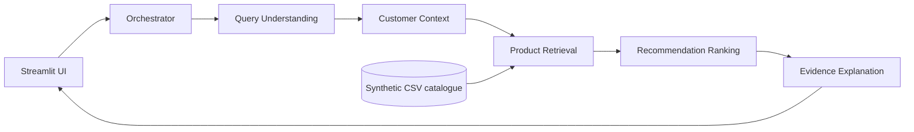

# Context Cart: Agentic RAG Product Recommendation

An academic demonstration of context-aware product recommendations using a five-agent orchestration workflow and TF-IDF retrieval. It runs locally without paid API keys.

## Abstract

Context Cart turns a natural-language shopping request and explicitly supplied preferences into ranked product recommendations. Five specialized Python agents parse the query, assemble ephemeral customer context, retrieve catalogue evidence, rank candidate products, and produce evidence-grounded explanations. The retrieval layer uses scikit-learn TF-IDF with metadata filtering; it is not a generative LLM or vector-database implementation. A deterministic catalogue of 120 synthetic products enables local experiments without retailer data or credentials.

## Problem and Objectives

Keyword product search does not consistently combine a shopper's intent, budget, brand preference, and channel context. This prototype demonstrates a transparent, testable architecture for combining those signals, displaying retrieved evidence, and measuring retrieval and ranking behavior against simple baselines.

## Features

- Natural-language query and explicit customer-context controls.
- Five separate agents coordinated by a central orchestrator.
- TF-IDF retrieval, category metadata filtering, and a transparent weighted ranking formula.
- Hard budget filtering when in-budget candidates exist; visible fallback behavior otherwise.
- Evidence-based product explanations, retrieval trace, and product comparison.
- Four-query evaluation of keyword, TF-IDF, context-aware TF-IDF, and five-agent ranking.
- Synthetic-data validation, pytest suite, sample JSON outputs, report PDF, and editable presentation.

## Technology

Python 3.11+ (validated in this workspace with Python 3.14), Streamlit, Pandas, NumPy, scikit-learn, Matplotlib, pytest, ReportLab, and python-pptx.

## Architecture



The system performs lexical TF-IDF retrieval. Dense embeddings, ChromaDB, external LLMs, and retailer integrations are intentionally not claimed or used. More diagrams are in [docs/diagrams/architecture.md](docs/diagrams/architecture.md).

## Run Locally

```bash
python3 -m venv .venv
source .venv/bin/activate
python -m pip install -r requirements.txt
streamlit run app.py
```

On first startup, `data/products.csv` is generated deterministically. Open the URL printed by Streamlit, normally `http://localhost:8501`. In Codespaces, use the forwarded port link.

## Tests and Evaluation

```bash
python -m pytest -q
python scripts/evaluate.py
python scripts/generate_demo_outputs.py
python scripts/build_submission_artifacts.py
```

Evaluation CSV files are in `outputs/evaluation/`. Three actual example results are in `outputs/examples/`. The evaluation relevance label is the synthetic product category, not human relevance judgments; see [report/report.md](report/report.md) for interpretation and limitations.

## Dataset

The 120 product records are generated by [src/recommender/catalog.py](src/recommender/catalog.py). Every record is labelled `synthetic demonstration data`; product attributes, prices, brands, and ratings are fictional. Field definitions and provenance are documented in [data/DATA_DICTIONARY.md](data/DATA_DICTIONARY.md) and [data/SOURCE.md](data/SOURCE.md).

## Project Map

```text
app.py                         Streamlit application
src/recommender/               catalogue, five agents, orchestration, evaluation
data/                          generated catalogue and data documentation
tests/                         unit and evaluation tests
scripts/                       evaluation, examples, submission artifact generation
outputs/examples/              actual recommendation/comparison/evidence JSON
outputs/evaluation/            measured metrics, per-query results, chart
docs/                          checklist, diagrams, security, deployment notes
report/                         report source and generated PDF
paper/                          IEEE-style research draft
presentation/                   editable 15-slide PPTX
video/                          8-12 minute script and recording checklist
FINAL_PROJECT_STATUS.md         completion and remaining limitations
```

## Security, Privacy, Limitations

There are no API keys or external services. The `.env.example` contains optional configuration names only. Customer context is request-scoped and not persisted. The application is an educational prototype, not a production recommender. Synthetic, category-labelled evaluation does not establish real-world relevance, fairness, causal impact, or performance improvement. Details and an optional Azure plan are in [docs/security_and_privacy.md](docs/security_and_privacy.md) and [docs/deployment.md](docs/deployment.md).

## Report, Paper, Presentation, Video

- [Project report source](report/report.md) and generated [PDF](report/project_report.pdf).
- [IEEE-style draft](paper/ieee_paper_draft.md); it is an editable text draft, not an official IEEE-template typeset paper.
- [Editable presentation](presentation/project_presentation.pptx).
- [Video script and recording checklist](video/).

## References

1. G. Salton and C. Buckley, “Term-weighting approaches in automatic text retrieval,” *Information Processing & Management*, vol. 24, no. 5, pp. 513–523, 1988, doi: 10.1016/0306-4573(88)90021-0.
2. P. Lewis et al., “Retrieval-Augmented Generation for Knowledge-Intensive NLP Tasks,” *Advances in Neural Information Processing Systems*, vol. 33, 2020.
3. F. Ricci, L. Rokach, and B. Shapira, Eds., *Recommender Systems Handbook*, 2nd ed. Springer, 2015, doi: 10.1007/978-1-4899-7637-6.
