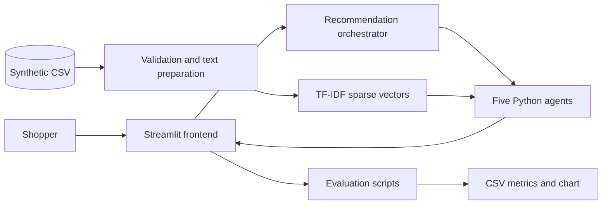
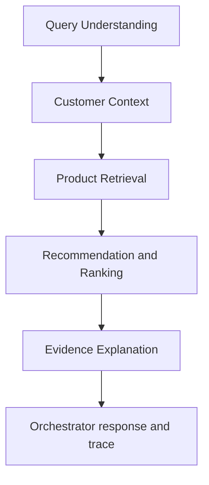
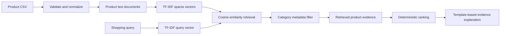
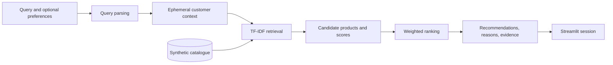
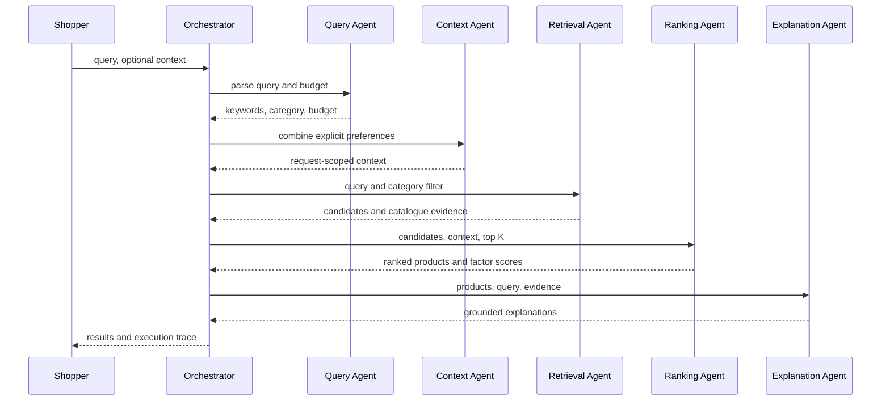
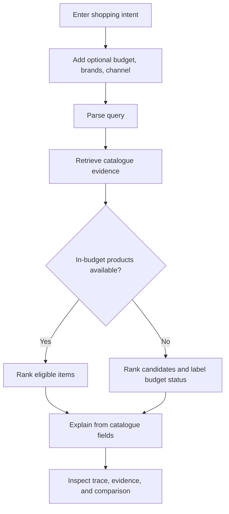

# Editable Architecture Diagrams

## 1. Overall System Architecture


## 2. Five-Agent Architecture


## 3. RAG Workflow

This is a lexical retrieval-augmented recommendation pipeline. It does not include an LLM, neural embeddings, or vector database.

## 4. Data-Flow Diagram


## 5. Agent Sequence Diagram


## 6. Deployment Architecture
```mermaid
flowchart LR
  Browser --> Streamlit[Local or Codespaces Streamlit app]
  Streamlit --> Python[Python process and in-memory TF-IDF index]
  Python --> CSV[(Local synthetic CSV)]
  subgraph Optional future cloud, not deployed
    Registry[Azure Container Registry] --> AKS[Azure Kubernetes Service]
    AKS --> API[FastAPI service]
    API --> Search[Azure AI Search]
    API --> Vault[Key Vault]
    API --> Monitor[Azure Monitor and App Insights]
    Pipeline[Azure DevOps] --> Registry
    IaC[Terraform] --> AKS
  end
```

## 7. Customer Recommendation Workflow
